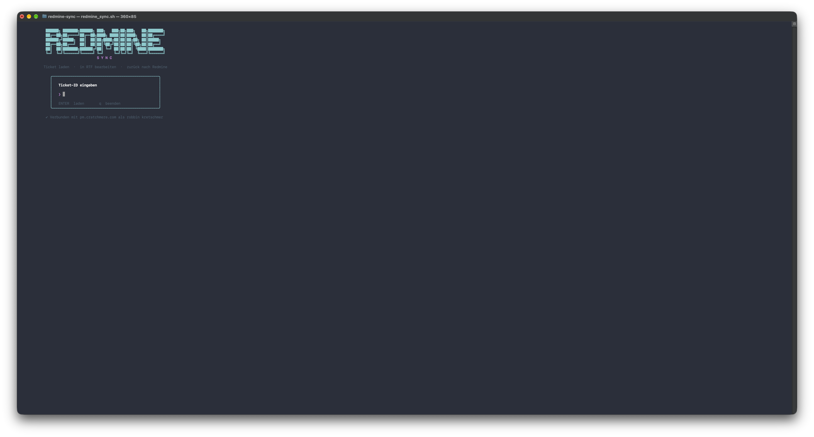
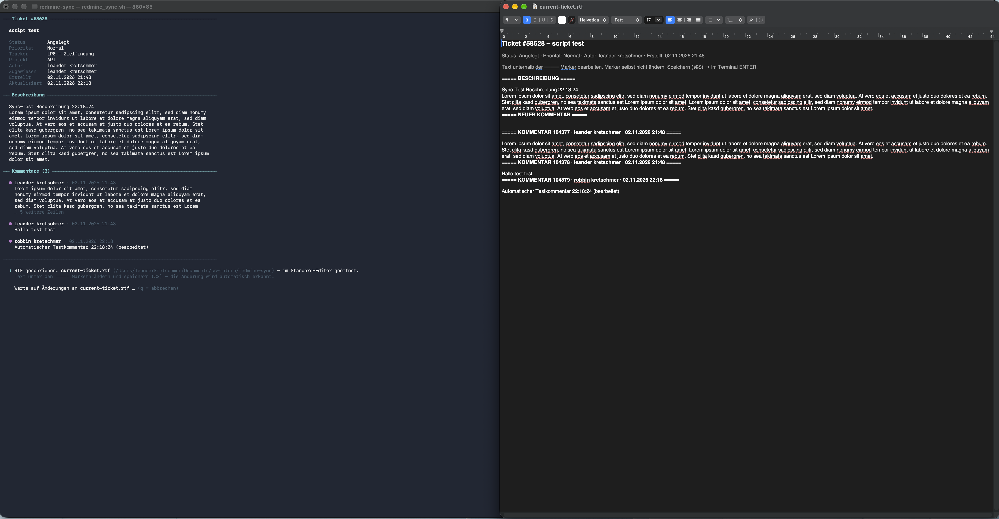
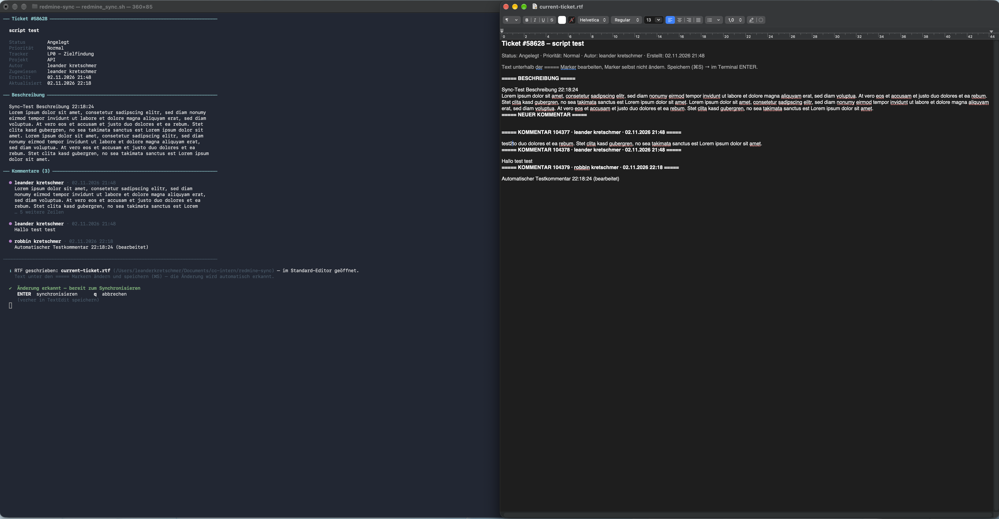

# comment-edit – Redmine-Tickets als RTF bearbeiten

## Prompt für ChatGPT

Wenn der Inhalt der `current-ticket.rtf` von ChatGPT überarbeitet werden soll, den Text zusammen mit diesem Prompt übergeben:

```text
Du bekommst den Inhalt eines Redmine-Tickets. Bearbeite ausschließlich den Inhalt
der Beschreibung und der Kommentare.

Regeln:
- Bearbeite niemals die Syntax oder Struktur der Datei.
- Marker-Zeilen (===== BESCHREIBUNG =====, ===== NEUER KOMMENTAR =====,
  ===== KOMMENTAR <ID> · <Autor> · <Datum> =====), Kopfzeilen, Reihenfolge und
  Formatierung bleiben exakt so, wie sie sind.
- Erlaubt ist nur das Bearbeiten, Entfernen oder Hinzufügen von Inhalten
  innerhalb der markierten Bereiche.
- Ein neuer Kommentar darf nur mit einer eigenen Marker-Zeile angelegt werden:
  == KOMMENTAR TT.MM.JJJJ HH:MM ==  und darunter der Text. Er darf an jeder
  Stelle zwischen den bestehenden Abschnitten stehen.
- Gib den kompletten Text mit unveränderter Struktur zurück.
```

Das Ergebnis in TextEdit einfügen, speichern (⌘S) – das Script erkennt die Änderung und synchronisiert nach ENTER.

---

## Was macht das Tool?

`redmine_sync.sh` ist eine kleine CLI-Oberfläche für macOS:

1. Ticket-ID eingeben → das Ticket wird im Terminal angezeigt
2. `current-ticket.rtf` wird neben dem Script geschrieben und im Standard-Editor (TextEdit) geöffnet
3. Datei bearbeiten und speichern → das Script erkennt die Änderung → ✔
4. **ENTER** synchronisiert nach Redmine → zurück zur Startseite, die RTF wird geleert

Synchronisiert werden:

| Abschnitt in der RTF | Wirkung in Redmine |
|---|---|
| `===== BESCHREIBUNG =====` | Beschreibung des Tickets wird aktualisiert (nur bei Änderung) |
| `===== NEUER KOMMENTAR =====` | Text darunter wird als neuer Kommentar angelegt (Zeitpunkt: jetzt) |
| `== KOMMENTAR TT.MM.JJJJ HH:MM ==` | neuer Kommentar mit diesem Zeitstempel – wird an der passenden Stelle im Ticketverlauf einsortiert |
| `===== KOMMENTAR <ID> · … =====` | bestehender Kommentar wird aktualisiert (nur bei Änderung) |

Leere Abschnitte oder fehlende Marker werden ignoriert – es wird nichts versehentlich gelöscht.

### Neue Kommentare mit Zeitstempel

An beliebiger Stelle in der RTF (z. B. zwischen zwei bestehenden Kommentaren) eine Marker-Zeile mit Datum und Uhrzeit einfügen, darunter den Text:

```text
== KOMMENTAR 01.11.2026 10:00 ==
Telefonat mit Kunde: Freigabe erteilt, Umsetzung ab Montag.
```

Beim Sync wird der Kommentar angelegt und über die Backdating-API des Plugins **redmine-extended-api** auf den angegebenen Zeitpunkt (lokale Zeit) datiert – Redmine sortiert ihn damit chronologisch korrekt in den Verlauf ein. Mehrere solcher Blöcke sind möglich; sie werden in Dateireihenfolge verarbeitet. Erlaubte Formate: `TT.MM.JJJJ HH:MM`, `TT.MM.JJJJ HH:MM:SS`, `JJJJ-MM-TT HH:MM`, nur Datum (= 00:00). Zwei oder mehr `=` am Zeilenanfang/-ende genügen.

Ist das Plugin nicht installiert oder die Funktion „Backdating“ in den Plugin-Einstellungen nicht aktiv, wird der Kommentar trotzdem angelegt – dann mit dem aktuellen Zeitpunkt, und das Script zeigt eine Warnung.

## Voraussetzungen

- macOS (nutzt `textutil` und `open`), Bash ≥ 3.2
- `curl` und `jq` (`brew install jq`)
- Redmine-API-Key: Redmine → *Mein Konto* → *API-Zugriffsschlüssel*
- Für datierte Kommentare: Plugin [redmine-extended-api](https://github.com/leanderkretschmer/redmine-extended-api) mit aktivierter Backdating-Funktion

## Einrichtung

```bash
chmod +x redmine_sync.sh
./redmine_sync.sh
```

Beim ersten Start werden Redmine-URL und API-Key abgefragt und in `.redmine_config` (neben dem Script) gespeichert. Alternativ `.redmine_config.example` kopieren und ausfüllen. Die Datei ist per `.gitignore` ausgeschlossen – **nie einchecken**.

## Ablauf

### 1. Startseite – Ticket-ID eingeben

Unten steht, mit welcher Redmine-Instanz und welchem Benutzer das Tool verbunden ist. Alle Änderungen laufen unter diesem Benutzer.



### 2. Ticket-Ansicht + RTF im Editor

Links das Ticket mit Metadaten, Beschreibung und den ersten Kommentaren. Rechts die automatisch geöffnete `current-ticket.rtf`. Das Terminal wartet, bis die Datei gespeichert wird (`q` bricht ab).

Nur den Text **unter** den `=====`-Markern ändern, die Marker selbst nicht anfassen. Neue Kommentare mit `== KOMMENTAR TT.MM.JJJJ HH:MM ==` einfügen.



### 3. Änderung erkannt → ENTER synchronisiert

Nach dem Speichern erscheint der grüne Haken. **ENTER** schickt die Änderungen nach Redmine, danach geht es zurück zur Startseite und die RTF wird geleert.



## Hinweise

- In der RTF stehen immer alle Kommentare in voller Länge; das Terminal zeigt nur die ersten 3 gekürzt an.
- TextEdit speichert automatisch; vor ENTER trotzdem mit ⌘S sichern, damit der letzte Stand synchronisiert wird.
- Abbruch mit `q` lässt die RTF unverändert; beim nächsten Ticket wird sie überschrieben.
- Zeilen, die mit `==` beginnen und enden, sind als Marker reserviert – nicht im Kommentartext verwenden.
